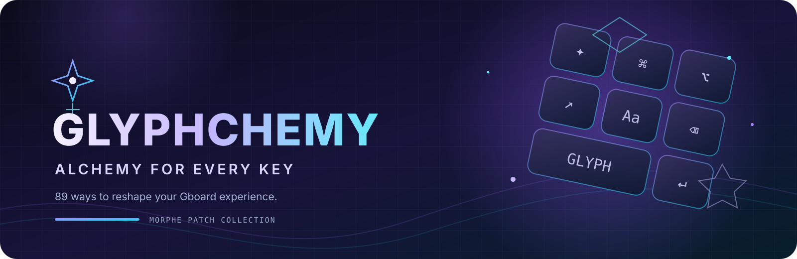
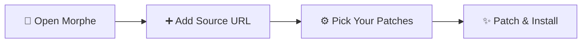

<div align="center">


<div align="center">

# ✧ G L Y P H C H E M Y ✧
### *Alchemy for Every Key.*

An ultra-refined, bespoke **Morphe** patch suite transforming **Google Gboard** into a powerhouse of customization, privacy, intelligence, and visual elegance.

[](https://github.com/assc0d3r/GLYPHCHEMY/releases/latest)
[](https://morphe.software/add-source?github=assc0d3r/GLYPHCHEMY)
[](https://play.google.com/store/apps/details?id=com.google.android.inputmethod.latin)
[](#-patch-vault-89-patches)
[](LICENSE)

<br/>

[🚀 **Quick Install**](#-quick-install) • [🧩 **Patch Vault**](#-patch-vault-89-patches) • [📱 **Compatibility**](#-compatibility-matrix) • [⚡ **Tasker Recipe**](#-tasker-automation) • [🛠️ **Build Guide**](#%EF%B8%8F-local-build--development)

---

</div>

## 🌟 Why Glyphchemy?

Glyphchemy is not just a tweak—it's a comprehensive runtime enhancement engine for **Gboard** (`com.google.android.inputmethod.latin`). It injects custom runtime logic, bypasses arbitrary feature rollouts, revives legacy ergonomics, and unlocks hidden engine flags.

<div align="center">

| 🎨 **Frosted Aesthetics** | 🧠 **Local & Cloud Voice** | 🔒 **Fortified Privacy** | ⚡ **Power Gestures** |
| :---: | :---: | :---: | :---: |
| Real-time background blur, OriginOS liquid glass bloom, rainbow RGB glide trail & custom themes | On-device 25+ language offline **NVIDIA Parakeet** or contextual server-side **Rambler** | Metric tracker blockers, signature bypass, cloud-backup cut, offline-only isolation | Directional case flicking, spacebar trackpad, swipe-to-delete & smart spacing |

</div>

---

## 📱 Compatibility Matrix

> [!NOTE]
> Morphe dynamically skips patches whose signatures are absent on your target build instead of aborting the installation.

| Target Gboard Version | Status | Patch Support |
| :--- | :---: | :--- |
| `18.6.3.1002251336-release-arm64-v8a` | `🟢 Verified Target` | **100% (All 89 Patches)** |
| `18.8.0.1022711984-beta-arm64-v8a` | `🟡 Experimental` | Frosted Glass, Smart Bar Case Swipe, Punctuation Spacing & Rambler ports |
| `18.5.4.993608717-release-arm64-v8a` | `🟢 Stable` | Core typing, gesture engine, theme system & field adaptation |
| `18.0.3.954559732-release-arm64-v8a` | `⚪ Legacy` | Glide Trail, Backspace Haptic Repeat, Enter Tasker Event |

---

## 🚀 Quick Install



### 1-Click Setup (Recommended)
1. **Tap the source badge** directly on your Android device:  
   👉 **[Add Glyphchemy to Morphe](https://morphe.software/add-source?github=assc0d3r/GLYPHCHEMY)**

### Manual Setup
1. In **Morphe**, head to **Settings** → **Sources**.
2. Tap **Add Source** and paste:
   ```text
   https://github.com/assc0d3r/GLYPHCHEMY
   ```
3. Navigate to **Patcher**, select **Gboard** (`18.6.3.1002251336-release-arm64-v8a`), choose your patch cocktail, and tap **Patch**.
4. Install and enjoy!

> [!WARNING]
> A patched APK cannot overwrite stock Gboard due to signature mismatch. Either install via root/Morphe mount, or enable the `Change package name` patch to run side-by-side.

---

## 🧩 Patch Vault (89 Patches)

> 💡 *Patches tagged with `⚠️ Inactive by default` carry invasive behavior (custom package names, offline isolation, shell triggers, or radical UI shifts). Review before enabling.*

<br/>

### ⌨️ Typing, Gestures & Cursor Control

<details>
<summary><b>Per-app profiles</b> <code>per-app-profiles</code></summary>
<br/>

> Context-aware keyboard orchestration. Automatically switch themes, toolbar orders, incognito learning, and height based on the active package or field type (URL, Email, Terminal, Password, etc.). Supports dynamic session overrides.
</details>

<details>
<summary><b>Field adaptation</b> <code>field-adaptation</code> <code>⚠️ Inactive by default</code></summary>
<br/>

> Dynamically modifies suggestion engines and auto-correct tolerances according to context (code fields, search bars, email inputs, and password masks).
</details>

<details>
<summary><b>Swipe Left to Delete</b> <code>swipe-left-delete</code></summary>
<br/>

> Slide left anywhere across the key array to delete characters like backspace; hold during slide to delete whole words continuously.
</details>

<details>
<summary><b>Smart bar case swipe</b> <code>smart-bar-case-swipe</code></summary>
<br/>

> Swipe **up** on any suggestion chip to force uppercase; swipe **down** for lowercase prior to insertion while preserving native Gboard spacing.
</details>

<details>
<summary><b>Spacebar double-tap tab/undo</b> <code>spacebar-doubletap-action</code></summary>
<br/>

> Double-tap left spacebar to insert a true Tab character; double-tap right spacebar to undo the previous action.
</details>

<details>
<summary><b>Punctuation spacing</b> <code>smart-punctuation-spacing</code></summary>
<br/>

> Intelligently strips preceding whitespace for punctuation hugging (`Hey .` ➔ `Hey.`). Fully respects French dual-punctuation space standards (`: ; ! ?`).
</details>

<details>
<summary><b>English QWERTY Flick Case</b> <code>qwerty-flick-case</code></summary>
<br/>

> Flick up on keys for instant uppercase, flick down for lowercase (overrides auto-capitalization).
</details>

<details>
<summary><b>Long-Press Editing Shortcuts</b> <code>long-press-shortcuts</code></summary>
<br/>

> Instant access to Select All, Undo, Cut, Copy, Paste, and Redo on English QWERTY and Zhuyin layouts.
</details>

<details>
<summary><b>Cursor trackpad mode</b> <code>cursor-trackpad</code></summary>
<br/>

> Long-press the spacebar to engage precision cursor navigation with trackpad locking mechanics.
</details>

<details>
<summary><b>Swipe Down to Dismiss Keyboard</b> <code>swipe-dismiss</code></summary>
<br/>

> Swipe downward from the candidate bar or toolbar to immediately dismiss the keyboard.
</details>

<details>
<summary><b>Backspace Repeat Haptic Feedback</b> <code>backspace-haptic-repeat</code></summary>
<br/>

> Triggers continuous, rhythmic haptic pulses via Gboard's native haptic player while backspace is held down, cutting off the moment cursor hits index 0.
</details>

<details>
<summary><b>Keypress Vibration Intensity Control</b> <code>vibration-intensity</code></summary>
<br/>

> Overrides basic duration sliders with precise amplitude/intensity haptic control.
</details>

<details>
<summary><b>Multilingual Suggestion</b> <code>multilingual-suggestion</code></summary>
<br/>

> Promotes suggestions written in secondary alphabets/scripts ahead of Latin candidates.
</details>

<details>
<summary><b>Latin Globe Key Ignore Interval</b> <code>globe-ignore-interval</code> <code>⚠️ Inactive by default</code></summary>
<br/>

> Custom ignore duration delay for language switches after rapid typing bursts.
</details>

<br/>

### 🎨 Visuals, Themes & Aesthetics

<details>
<summary><b>Frosted Glass</b> <code>frosted-glass</code></summary>
<br/>

> Real-time live background Gaussian blur and customizable transparency across the board. Independent key and background opacity sliders with optional navigation bar passthrough. *(Requires Android 12+)*.
</details>

<details>
<summary><b>Glass Press Effect & Panel</b> <code>glass-press-effect</code></summary>
<br/>

> vivo OriginOS-style liquid glass touch feedback: blooming illumination radiating from finger contact points paired with mechanical key dipping animations.
</details>

<details>
<summary><b>Glide Trail Customization</b> <code>glide-trail-customizer</code></summary>
<br/>

> Total control over gesture typing trails: fade duration (200–4000ms), thickness (2–40dp), tail points (5–100), full HSV color wheel presets, and dynamic Rainbow RGB modes.
</details>

<details>
<summary><b>Theme Follows Dark Mode</b> <code>theme-follow-system-dark</code></summary>
<br/>

> Seamless dual-theme switching with independent day/night image wallpapers tied to system theme toggles.
</details>

<details>
<summary><b>Gboard Theme Builder & Custom Theme Importer</b> <code>theme-builder-importer</code></summary>
<br/>

> Native in-app theme creation runtime + one-tap ZIP theme pack importer with sha256 checksum verification.
</details>

<details>
<summary><b>AMOLED Dark Keyboard & Settings</b> <code>amoled-pure-black</code> <code>⚠️ Inactive by default</code></summary>
<br/>

> Replaces dark grey backgrounds with authentic pitch black (`#000000`) across all keyboard layouts, settings lists, and preference screens.
</details>

<details>
<summary><b>Keyboard Icon Packs & Custom Spacebar Icon</b> <code>icon-packs-spacebar-logo</code></summary>
<br/>

> Replace system symbols with custom raster icon packs; display custom PNG/WebP images or vector badges directly inside the spacebar.
</details>

<details>
<summary><b>Key Shape & Rounded Panel Geometry</b> <code>key-shape-rounded-corners</code></summary>
<br/>

> Unlocks custom key geometry profiles and independent top/bottom corner radiuses for floating and docked keyboards.
</details>

<details>
<summary><b>Immersive Keyboard</b> <code>immersive-landscape</code></summary>
<br/>

> Extends landscape layout underneath display cutouts/notches without unsightly black side spacers.
</details>

<details>
<summary><b>Translucent Bottom Bar & Emoji Placement</b> <code>translucent-bottom-bar</code></summary>
<br/>

> Harmonizes navigation filler strips with custom theme blur, and allows shifting the emoji trigger to the right of the spacebar.
</details>

<br/>

### 🎙️ Advanced Voice Engines

<details>
<summary><b>NVIDIA Parakeet Voice Typing (Offline)</b> <code>voice-parakeet</code></summary>
<br/>

> Pure on-device neural transcription powered by NVIDIA Parakeet (TDT v3 / Moondream Ultra). Transcribes 25+ languages locally with zero server roundtrips. Includes a personalized spelling dictionary.
</details>

<details>
<summary><b>Google Rambler Voice Suite</b> <code>voice-rambler</code></summary>
<br/>

> Server-side conversational voice transcription with cursor-aware edits, custom instructions ("write numbers as digits"), contact dictionary injection, and silence auto-stops.
</details>

<details>
<summary><b>Advanced Voice Tools & Bundled OCR</b> <code>advanced-voice-ocr</code></summary>
<br/>

> Unlocks auto-punctuation, Bluetooth microphone routing, and an on-device OCR camera scanner requiring zero Play Services dependencies.
</details>

<br/>

### ✍️ AI Writing, Suggestions & Clipboard

<details>
<summary><b>AI Writing Suite & Inline Suggestions</b> <code>ai-writing-suite</code></summary>
<br/>

> Enables Gboard's locked writing tools (rewrite, proofread, tonal shifts), Smart Compose, grammar check, and inline autofill.
</details>

<details>
<summary><b>Web Clipboard Portal</b> <code>web-clipboard-portal</code></summary>
<br/>

> Embedded local LAN server: sync desktop clipboards to your phone over Wi-Fi with PIN security and Quick Settings Tile toggling.
</details>

<details>
<summary><b>Clipboard Supercharger</b> <code>clipboard-supercharger</code></summary>
<br/>

> Infinite retention periods, customizable text character caps (surpassing 20,000 chars), preview line counts, and creation timestamps.
</details>

<details>
<summary><b>Simple Inline Calculator</b> <code>inline-calculator</code></summary>
<br/>

> Type mathematical expressions directly into text fields and receive real-time answers in the suggestion strip.
</details>

<details>
<summary><b>LAN FTP Server & Floating Web Browser</b> <code>ftp-floating-search</code></summary>
<br/>

> Turn Gboard into a background FTP server for direct device file retrieval, or perform quick lookups via an overlay browser without leaving your app.
</details>

<br/>

### 🔒 Privacy Hardening & System Sanitization

<div align="center">

| Patch | Purpose | Default State |
| :--- | :--- | :---: |
| **Block Trackers** | Disables background analytics, telemetry & crash reporters | `Active` |
| **Stop Remote Updates** | Freezes Google server flags from reverting modifications | `Active` |
| **Add Signature Bypass** | Enables APK installation without original signature match | `Active` |
| **Offline Only** | Severely cuts all network sockets & permissions | `⚠️ Inactive` |
| **Disable Play Services**| Operates in total independence from microG / GMS | `⚠️ Inactive` |
| **Key Mapper Watchdog** | Bridges Shizuku system control for automation | `⚠️ Inactive` |

</div>

<br/>

### ⌨️ Alternate Layouts & Ergonomics
- **iOS QWERTY & Flick Layouts:** Emulate native iOS layout geometry, Japanese 12-key flicks, and symbols pages.
- **Split & Accessibility Frameworks:** Unlocks native tablet split modes and large-format accessibility views.
- **Zhuyin Slide Input & Tuning:** Slide gestures for dual-alphabet typing and custom bottom-row geometry.

---

## ⚡ Tasker Automation

With the **Enter Key Tasker Event** patch enabled, every enter stroke or IME action sends a low-latency broadcast:

```text
Action: dev.custom.gboard.ENTER_PRESSED
```

### Received Variables

| Variable | Description | Example Payload |
| :--- | :--- | :--- |
| `%package` | Active foreground application | `com.whatsapp`, `org.telegram.messenger` |
| `%action_type` | Action identifier triggered | `ENTER`, `SEND`, `SEARCH`, `DONE`, `GO` |
| `%key_code` | Raw keycode identifier | `66` *(Enter)*, `-10018` *(IME Action)* |
| `%text_before`| Text preceding cursor (up to 100 chars) | `"https://github.com/..."` |
| `%timestamp` | Epoch execution time in milliseconds | `1726831000000` |

---

## 🛠️ Local Build & Development

Compile your own `.mpp` patch bundles with the automated toolchain:

```bash
# 1. Clone the repository
git clone https://github.com/assc0d3r/GLYPHCHEMY.git
cd GLYPHCHEMY

# 2. Compile patches, bytecode runtimes & create .mpp bundle
./build.sh
```

### Output Artifacts (`dist/`)
- `patches-<version>.mpp` — The complete Morphe bundle.
- `gboard-backspace-haptics.jar` — Standalone Java runtime package.

### Syncing `patches-list.json`
To reflect new patches in Morphe's inventory:

```bash
java -cp "libs/morphe-cli.jar:libs/gson.jar" tools/bindings/Inventory.java \
  dist/patches-$(sed -n 's/^version=//p' gradle.properties).mpp \
  $(sed -n 's/^version=//p' gradle.properties) \
  patches-list.json
```
*(On Windows cmd/powershell, replace `:` with `;`)*

---

<div align="center">

### ⚖️ License & Acknowledgments

This project is licensed under the **GNU General Public License v3.0** — see [LICENSE](LICENSE) for details.

Gboard is a trademark of Google LLC. This project is independently developed and not affiliated with Google.

⭐ **Enjoying Glyphchemy? Star this repository to support development!** ⭐

</div>
